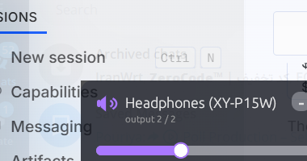
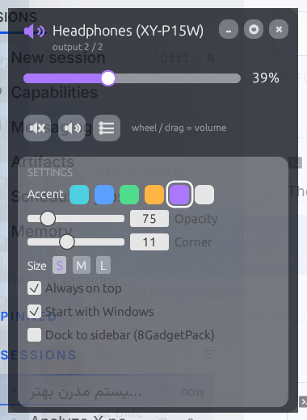

# Audio Widget

A modern, borderless, semi-transparent **system volume controller for Windows**, written in **Rust (egui/eframe)** — no Python runtime.

Lives as a **single tray icon** in the notification area (right side of the taskbar). No taskbar button, no floating window until you ask for it.

## فارسی

**Audio Widget** یک کنترل‌کنندهٔ صدای سیستم برای ویندوز است — مدرن، بدون حاشیه، با پس‌زمینهٔ نیمه‌شفاف — نوشته‌شده با **Rust (egui)** و یک هلپر کوچک **C# (CoreAudio)**. بدون پایتون در زمان اجرا.

- **فقط یک آیکون در tray** (سمت راست taskbar): بدون دکمهٔ taskbar و بدون پنجرهٔ شناور تا وقتی خودتان بخواهید. کلیک چپ = نمایش/مخفی؛ کلیک راست = خروج.
- **کارت شیشه‌ای بدون حاشیه**: شفافیت پس‌زمینه و گردی گوشه‌ها قابل تنظیم.
- **اسلایدر صدا + چرخ موس** روی کارت (نرم و بدون پرش؛ مقدار تا پایان تنظیم کاربر حفظ می‌شود).
- **میوت**، **سوییچ دستگاه خروجی** (لیست همهٔ دستگاه‌های فعال + علامت پیش‌فرض).
- **پنل تنظیمات**: رنگ accent (۶ حالت)، شفافیت، گردی گوشه، اندازه (S/M/L)، همیشه روی پنجره‌ها، اجرا با ویندوز، dock اختیاری زیر گجت‌های 8GadgetPack.
- تنظیمات در `%APPDATA%\AudioWidget\settings.ini` ذخیره می‌شود.

**اجرا:** هلپر را با `helper\build.cmd` بسازید و `AudioSwitch.exe` را در `%LOCALAPPDATA%\AudioSwitch\` بگذارید؛ سپس `cargo build --release` و اجرای `audio_widget.exe` (همان اول به tray می‌رود). `widget.ico` باید کنار exe باشد.

**کنترل‌های tray:** کلیک چپ = باز/بسته · کلیک راست = خروج · دکمهٔ `—` = برگشت به tray · چرخ‌دنده = تنظیمات · `✕` = خروج.

## Screenshots

| widget | settings |
|---|---|
|  |  |

## Features

- **Tray-only presence**: starts hidden (minimized, no taskbar button). Left-click the tray icon to show/hide the widget; right-click to exit.
- **Borderless glass card**: no border/shadow/margin, adjustable background opacity and corner radius.
- **Volume slider + mouse-wheel** over the card (smooth, debounced — no slider jitter while the backend refreshes).
- **Mute toggle**, **output-device switcher** (lists all active render endpoints, marks the default).
- **Settings panel**: accent color (6), opacity, corner radius, size (S/M/L), always-on-top, start-with-Windows, optional dock-to-sidebar.
- Settings persist to `%APPDATA%\AudioWidget\settings.ini`.
- Optional dock under an open 8GadgetPack / Windows Sidebar gadget column.

## Architecture

```
egui UI (main thread)  --cmd-->  worker thread  --spawns-->  AudioSwitch.exe (C#, CoreAudio)
                       <--state--                <--reads--   %TEMP%\audioswitch_out.txt (UTF-16)
tray icon: raw Win32 Shell_NotifyIconW (no extra crate)
```

The C# helper (`helper/AudioSwitch.cs`) talks to Windows CoreAudio (MMDeviceEnumerator / IAudioEndpointVolume) and writes a small UTF-16 state file; the Rust worker polls it and applies commands. This keeps the UI process free of COM apartment issues.

## Build

### 1. Helper (C#, ships with Windows)

```cmd
cd helper
build.cmd
```

Copy the produced `AudioSwitch.exe` to `%LOCALAPPDATA%\AudioSwitch\AudioSwitch.exe`.

### 2. Widget (Rust, GNU toolchain)

```bash
cargo build --release
```

Pinned to `egui/eframe =0.31.1` (glow renderer). Put `widget.ico` next to the built `audio_widget.exe` (it is the tray icon). Regenerate it with `python gen_ico.py` if you want a different color (PIL only, build-time).

Run `audio_widget.exe`; it minimizes to the tray immediately.

## Tray controls

| Action | Effect |
|---|---|
| Left-click icon | show / hide widget |
| Right-click icon | exit |
| `—` in widget header | hide back to tray |
| gear | settings |
| `✕` | exit |

## License

MIT
